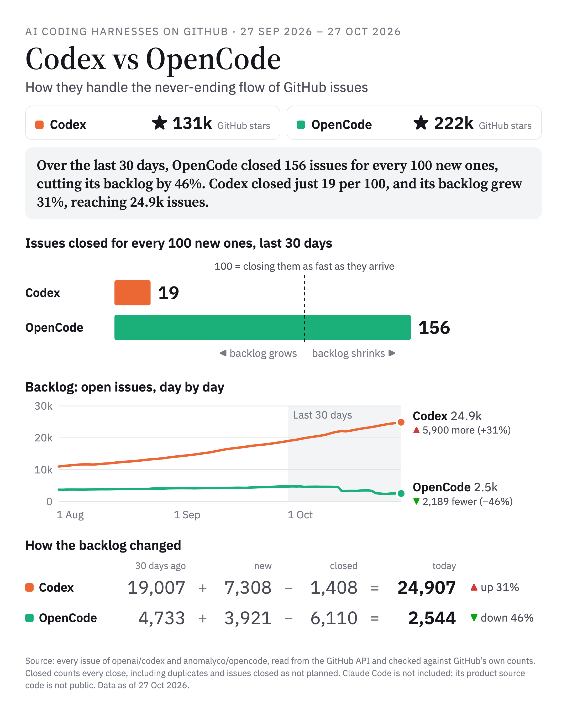

# AI coding harnesses on GitHub

How do the teams behind AI coding agents keep up with their own GitHub repositories? This project downloads every issue and pull request of three agent harnesses, measures them area by area, checks the numbers against GitHub's own counts, and turns them into reports, a dashboard and images for social posts.

| Key | Repository | Product source |
|---|---|---|
| `claude-code` | [anthropics/claude-code](https://github.com/anthropics/claude-code) | Private. The repository holds the issue tracker, plugins and examples. |
| `codex` | [openai/codex](https://github.com/openai/codex) | Public |
| `opencode` | [anomalyco/opencode](https://github.com/anomalyco/opencode) | Public |

It also measures the agents at work elsewhere: pull requests signed by each agent in any public repository on GitHub.

## Snapshot: 27 Oct 2026, last 30 days



| | Claude Code | Codex | OpenCode |
|---|---:|---:|---:|
| GitHub stars | 153,575 | 131,257 | 222,277 |
| New issues | 7,732 | 7,308 | 3,921 |
| Issues closed | 5,214 | 1,408 | 6,110 |
| Closed for every 100 new | 67 | 19 | 156 |
| Open issues at the end | 15,139 (+20%) | 24,907 (+31%) | 2,544 (−46%) |
| PRs merged | 13 ¹ | 1,270 ² | 1,611 |

¹ Public repository only. The product code is private, so its PRs say little about delivery.
² 99% are copies synced from an internal repository by the `copyberry` account.

"Closed" counts every close, including duplicates and issues closed as not planned. All the numbers above matched GitHub's search counts within 1%.

Agent-signed PRs in other people's repositories, created 20 Sep – 19 Oct 2026:

| | Claude Code | Codex | OpenCode | Unsigned PRs |
|---|---:|---:|---:|---:|
| Signed PRs found | 7.1M | 1.2M | 4.2k | 15.7M |
| Merged | 96% | 92% | 84% | 83% |
| Median lines changed | 229 | 359 | 297 | 158 |
| Issue opened → fix merged (median) | 6.7 h | 5.6 h | 7.5 h | 12.8 h |

Visible volume is a floor, not a usage share: each tool leaves a different trace, and some leave none. See [Agent PRs across GitHub](#agent-prs-across-github).

## Outputs

Every run writes these. They are generated files and are not committed, except the snapshot images above.

- **Executive report** (`reports/harness-report_*.html`): one self-contained page for leadership. It covers one period (the last 30 days by default) against the period before. It shows issue and PR flow, usage relative to stars and downloads, the leader in each area, a watch list and a scorecard.
- **Overview** (`reports/harness-overview_<date>.html`): the long view, month by month since each launch:
  - issues opened against closed, with a monthly table;
  - PRs opened, merged and closed without merging;
  - open issues and open PRs at each month end;
  - commits landing on the default branch, and time to merge;
  - how big issues and PRs are.
- **Social image** (`reports/harness-social_<date>.png`): one 1080×1350 image of the three repositories for a LinkedIn post. It has two findings, each with the chart behind it: open issues day by day over 90 days, and issues received against issues closed over the last 30 days (closes split into resolved and not resolved). Below them are GitHub stars and merged PRs.
- **Head-to-head image** (`reports/harness-social-codex-vs-opencode_<date>.png`): Codex and OpenCode only, the two whose product source is public. It focuses on how each handles its issues:
  - GitHub stars;
  - issues closed for every 100 new ones, against the 100 mark where the backlog holds still;
  - the backlog day by day;
  - the sum behind the change (open 30 days ago + new − closed = open today).

  Pick another pair with `social_pair.py --repos A,B`.
- **Agent PRs across GitHub** (`reports/harness-agents_<date>.html`): which agent ships more code and fixes problems faster, from PRs that carry Claude Code's, Codex's or OpenCode's signature in any public repository. It also summarizes what benchmarks and outside studies report.
- **Dashboard** (`dashboard/index.html` and `data/dashboard/*.json`): the full monthly history in seven tabs (summary, issue flow, closing, bugs, PRs, usage, method). It is published as a claude.ai Dashboard artifact.

The findings written on the images and reports are composed from the numbers on every run, so they stay true when the data changes.

## Requirements

- [GitHub CLI](https://cli.github.com), signed in with `gh auth login`. The scripts use its token, or `GH_TOKEN` if set, for the GraphQL and REST APIs.
- Python 3.9 or newer. Only the standard library is used, so there is nothing to install.
- macOS or Linux, because file locks use `fcntl`.
- Google Chrome or Chromium, to render the PNG images. Without it, the images are written as HTML only.
- Network access to `api.github.com` and `registry.npmjs.org`.

## Quick start

```bash
git clone <this repository>
cd <this repository>
scripts/run.sh
```

That single command:

1. fetches the issues and PRs that changed since the last run, or everything for any repository not fetched yet;
2. fetches releases, repository totals, search counts, npm downloads and Claude Code's CHANGELOG;
3. recomputes every metric;
4. rebuilds the dashboard;
5. writes the executive report for the last 30 days, the overview and both social images;
6. checks the numbers against GitHub's own counts;
7. rebuilds the agent PR comparison. Its sample is redone once a week and takes about 30 minutes; on other days the page is rebuilt from the last sample.

The first run downloads about 160k issues and PRs and takes about 40 minutes, mostly waiting on GitHub's rate limits. Add `--no-agents` to skip the 30-minute agent sample. After that, a run takes about two minutes, plus the weekly agent sample.

### Options

```bash
scripts/run.sh                      # incremental refresh, then rebuild everything
scripts/run.sh --no-fetch           # rebuild from the data already on disk
scripts/run.sh --full               # finish or resume a full download of every repository
scripts/run.sh --fresh              # delete fetched data and download everything again
scripts/run.sh --no-agents          # skip the agent PR comparison

scripts/run.sh --days 7             # report on the last 7 days instead of 30
scripts/run.sh --month 2026-09      # report on a calendar month (vs the month before)
scripts/run.sh --as-of 2026-10-01T00:00:00Z   # read the data as it stood at that time
```

`--days` and `--month` only change the executive report. `--as-of` applies to the metrics, the dashboard, the reports and the images. It drops issues created later and treats later closes and merges as not yet happened, so you can rebuild a past snapshot from today's data.

### Running a single step

Each step can also be run on its own from `scripts/`:

```bash
python3 fetch_items.py codex issues --update     # or --full [--fresh]; see --help
python3 fetch_extras.py                          # releases, repo totals, search counts, npm, changelog
python3 analyze.py [--as-of ISO]                 # -> data/metrics.json, data/monthly_<repo>.csv
python3 export_dashboard.py                      # -> data/dashboard/*.json
python3 ../dashboard/build.py                    # -> dashboard/index.html
python3 report.py [--days N | --month YYYY-MM] [--as-of ISO] [--out PATH]
python3 overview.py [--since YYYY-MM] [--as-of ISO] [--out PATH]
python3 social.py [--days N] [--as-of ISO] [--out PATH]
python3 social_pair.py [--repos codex,opencode] [--days N] [--as-of ISO] [--out PATH]
python3 validate.py [--days N] [--as-of ISO]    # cross-check against GitHub's own counts
python3 agents.py [--days N] [--settle N] [--sample N] [--no-fetch | --reuse-days N]
```

### Running it on a schedule

The pipeline is safe to rerun at any time:

- downloads resume from where they stopped;
- each stream holds a lock, so two runs never fetch the same data at once;
- an incremental run re-reads one hour before the previous sync, to catch items edited mid-fetch.

For a weekly refresh, a cron entry is enough. Cron runs with a minimal `PATH`, so set one that finds `gh` and `python3`:

```cron
PATH=/opt/homebrew/bin:/usr/local/bin:/usr/bin:/bin
0 7 * * 1  cd /path/to/this/repository && scripts/run.sh >> data/run.log 2>&1
```

## Repository layout

```
scripts/      the pipeline: fetching, metrics, reports, images, checks, and run.sh
dashboard/    the dashboard page template (page.html) and its builder
reports/      generated reports and images; only the published snapshots are committed
data/         downloaded and derived data; not committed, rebuilt by run.sh
```

| Path | What it is |
|---|---|
| `reports/harness-report_<YYYY-MM-DD>_<N>d.html` | Executive report for the last N days |
| `reports/harness-report_<YYYY-MM>.html` | Executive report for a calendar month (`-to-date` while the month is running) |
| `reports/harness-overview_<YYYY-MM-DD>.html` | Overview: monthly history since launch, merges into the default branch, sizes |
| `reports/harness-social_<YYYY-MM-DD>.png` | Three-repository image for a social post (and its HTML) |
| `reports/harness-social-<a>-vs-<b>_<YYYY-MM-DD>.png` | Head-to-head image for two repositories (and its HTML) |
| `reports/linkedin-post*_<YYYY-MM-DD>.png` | Frozen copies of images as published; runs never overwrite them |
| `reports/harness-agents_<YYYY-MM-DD>.html` | Agent PRs across GitHub: volume, merges, speed, size, fixes |
| `data/raw/` | Downloaded issues, PRs, releases, stars and npm downloads (about 190 MB) |
| `data/raw/agents/<YYYY-MM-DD>.json` | The agent PRs read for that comparison, with their weights and the search counts |
| `data/metrics.json` | Every metric, overall and by month, for each repository |
| `data/monthly_<repo>.csv` | The monthly series as CSV, for spreadsheets |
| `data/dashboard/*.json` | The five datasets the dashboard reads |

The reports are plain HTML with inline SVG charts and no scripts. They open offline, print cleanly, and can be attached to an email or saved as PDF from the browser.

## How it works

```
fetch_items.py ─┐
                ├─> data/raw/ ──> analyze.py ──> data/metrics.json ──> export_dashboard.py ──> data/dashboard/*.json ──> dashboard
fetch_extras.py ┘                   │
                                    └── classify.py (shared rules) ──> report.py, overview.py, social*.py ──> reports/
                                                                       validate.py ──> GitHub search counts

agents.py ──> GitHub search (all public repositories) ──> data/raw/agents/ ──> reports/harness-agents_*.html
```

| Script | Role |
|---|---|
| `config.py` | Which repositories to compare, their colors, and how each one's bugs and fixes are identified. |
| `common.py` | GitHub API access with retries and rate-limit back-off, file paths, sync state, loading items, and CHANGELOG parsing. |
| `fetch_items.py` | Downloads issue or PR metadata through GraphQL. |
| `fetch_extras.py` | Releases, star and issue totals, who may open PRs, search counts (open issues without comments, most-reacted open issues), Claude Code's CHANGELOG and its npm publish times, and daily npm downloads of each CLI. Appends the star count to `data/raw/stars_history.jsonl` on every run. |
| `classify.py` | The rules shared by the metrics and the reports: what counts as a bug, a fix, an automated close, a team member or an outside contributor, and how `--as-of` cuts the data. |
| `analyze.py` | Computes every metric, overall and per month. |
| `export_dashboard.py` | Shapes the metrics into the dashboard datasets. |
| `report.py` | Builds the executive report. |
| `overview.py` | Builds the overview: monthly history since launch and issue and PR sizes. |
| `social.py` | Builds the three-repository image for social posts, and its PNG. |
| `social_pair.py` | Builds the head-to-head image for two repositories, and its PNG. |
| `validate.py` | Recomputes the period numbers and compares them with GitHub search counts for the same timestamps. |
| `agents.py` | Samples agent-signed PRs across public GitHub and builds the agent PR comparison. |
| `run.sh` | Runs everything in order. |

How `fetch_items.py` downloads:

- **Full download**: walks each repository from both ends at once and writes `data/raw/<repo>_<kind>_{asc,desc}.jsonl`.
- **Update**: writes only the items updated since the last sync to `data/raw/updates/`. When the data is loaded, newer records replace older ones.
- **Sync state**: the time of each repository's last sync is kept in `data/raw/sync_state.json`. The reports read the data as of the oldest of these times, so every repository is cut at the same moment.

## What the metrics mean

**Issue flow**
- **Open backlog**: issues created before a given time and not closed by then.
- **Net**: new issues minus closed issues. Above zero, the backlog grows.
- **Closed for every 100 new**: 100 means closing issues as fast as they arrive. Below 100 the backlog grows; above it, it shrinks.

**How issues are closed**
- **Resolved**: closed with GitHub's reason *completed*. GitHub also records *not planned* and *duplicate*.
  - A *completed* close is not always a code fix; it is also used when a question is answered.
- **Resolved per 100 new**: completed closes in the period for every 100 issues opened in it.
- **Automated closes**: closes of issues carrying `stale`, `autoclose` (Claude Code) or `pending close` (OpenCode) labels. Codex does not close inactive issues.

**Speed**
- **First-week close rate**: share of new issues closed within 7 days.
  - In the report, it uses issues opened from 7 days before the period start to 7 days before its end, so every issue counted has had a full week.
- **Days to close**: from creation to the latest close, as a median.

**Bugs**
- Claude Code and Codex: the `bug` label or a `[BUG]` / `bug:` title.
- OpenCode does not label issue types, so its bugs are estimated from title wording (error, crash, fails, not working…).
  - Tested on the two labelled repositories: about 7 in 10 issues it flags are labelled bugs in Claude Code (9 in 10 in Codex), and it finds between half and four fifths of the labelled bugs. Treat OpenCode bug counts as an order of magnitude.

**Fixes shipped**
- Claude Code's source is not public, so its CHANGELOG "Fixed" entries are counted, dated by each version's npm publish time.
- Codex and OpenCode: merged PRs whose title starts with "fix".
- Codex PRs are synced from an internal repository by the `copyberry` account, with descriptive titles that rarely say "fix", so Codex's count is a floor.
- Compare trends within each repository rather than raw counts across them.

**People and releases**
- **Team**: everyone who has merged a PR (which needs write access), plus anyone GitHub marks as owner, member or collaborator.
  - Many employees hide their organization membership and appear as plain contributors, so the author's role alone would overstate outside work.
- **Outside contribution**: merged PRs whose author is not on the team, not a bot and not `copyberry`.
- **Versions**: GitHub releases for Codex and OpenCode. Claude Code's GitHub releases only start in December 2025, so its CHANGELOG versions are counted instead.

**Pull requests**
- **Open PRs**: created before a given time and not yet merged or closed.
- **Closed PRs that were merged**: merged PRs over all PRs closed in the period, merged or not.
- **Who can open PRs**: the repository's PR creation setting. Claude Code and Codex are set to *collaborators only*, so outsiders cannot open PRs there; only OpenCode accepts them.

**Usage and audience**

Both signals are imperfect. Trends within one repository are more reliable than levels across repositories.

- **GitHub stars** measure developer attention.
  - GitHub gives only today's count; it does not list when each star was given (the stargazer list comes back empty for these repositories).
  - Every run records the count, so stars gained per period become measurable once runs bracket a period.
  - Per-star ratios (new issues per 1,000 stars, outside PRs per 1,000 stars) use the latest count.
- **npm downloads** are the daily counts of `@anthropic-ai/claude-code`, `@openai/codex` and `opencode-ai` from the npm downloads API.
  - They miss native installers, Homebrew, install scripts and release binaries.
  - CI pipelines count on every run, and downloads are not users.
  - Each period uses its **median day**. The median leaves out days npm reported as zero (its stats outages and the latest one or two days) and automated download storms. For example, Codex jumped from about 1M to 46M a day for a week in May 2026.
- **New issues per 100k downloads**: issues opened for every 100,000 downloads, using the median day times the number of days.

**Merges and size**
- **Default branch**: `main` for Claude Code and Codex, and `dev` for OpenCode.
  - "Commits landing on the default branch" is GitHub's count of that branch's history per month. With squash merges, each merged PR is one commit.
  - "Time to merge" is from opening a PR to merging it into that branch, as a median by month of merge.
- **PR size**: lines added plus lines deleted. Buckets: XS under 10, S 10–99, M 100–499, L 500–999, XL 1,000+.
- **Issue size**: GitHub has no size field for issues, so it is measured three ways:
  - by discussion: comments, counted on issues at least a month old;
  - by time: days from opening to a completed close;
  - by fix: lines changed by the merged PRs that declare they close the issue. This only covers linked issues, and none for Claude Code, whose source is private.

### Agent PRs across GitHub

These measure the tools at work in other people's repositories, not how each team runs its own repository.

- **Cohort**: PRs created in the 30 days that end 7 days before the run, so each has had a week to be reviewed. Status is as of the run.
- **Signatures**: Claude Code's "Generated with Claude Code" line or a `claude/` branch; a `codex/` branch, which marks PRs from Codex cloud; OpenCode's "Generated with opencode" line or an `opencode/` branch. The repositories of Anthropic, OpenAI and Anomaly/SST are left out.
- **Visible volume is a floor**: PRs made without a trace are invisible, and each tool leaves its trace differently. For example, the local Codex CLI leaves none. So volumes are not usage shares; the rates, times and sizes are the comparable part.
- **Strata and checks**: each agent's searches are split so they do not overlap. A quoted phrase in GitHub search matches its words anywhere, so every PR read is also checked for the exact line or branch, and PRs without it are dropped. The share that passes is shown as "signature confirmed".
- **Sampling**: signatures with up to 4,000 PRs are read in full. Larger ones are read as the first 25 PRs of randomly placed time slices, about 1,000 PRs each. Each PR is weighted by how many PRs its slice held, so medians and shares stand for the whole cohort.
- **Unsigned PRs**: a reference group of public PRs with none of these signatures. Copilot and Cursor branches and dependency bots are left out.
- **Merged**: merged by the time of the run, over PRs not left in draft. **Time to merge**: from opening to merging. **Size**: lines added plus deleted.
- **Fixes**: merged PRs whose title starts with "fix" or that name an issue they close. **Issue to fix**: time from the issue being opened to the PR being merged. It uses only PRs that name the issue, and is shown with 30 or more.
- **Lines added in total**: summed over merged PRs, counting at most 5,000 per PR so lockfiles and vendored code do not dominate.

### Not measured

- Time to first response and who closed each issue. Both need each issue's timeline, which is one extra API call per issue.
- Issues deleted or hidden by GitHub. The API returns them as empty records, which are skipped.
- Star history before the first run, for the reason above.

## Checking the numbers

`validate.py` runs at the end of `run.sh`, and on its own with `python3 scripts/validate.py`. For the last 30 days it compares the data on disk with GitHub's own search counts over the exact same timestamps:

- new issues, closed issues, completed closes and merged PRs;
- open issues at the start and end of the period, counted as created before that time and either still open or closed after it;
- the identity open at end = open at start + new − closed;
- the star count.

It exits non-zero if anything differs by more than 1% and by more than 5 items.

On the run of 27 Oct 2026, every check was within 1%. The few differences were of a single issue (most likely one deleted or hidden after it was counted) or a handful of stars gained between the run and the check.

`agents.py` checks itself the same way. For each signature, the share of PRs merged in what it read is compared with GitHub's search counts. A signature read in full must match exactly; a sampled one must agree within its sampling margin. It exits non-zero otherwise.

## Adding or swapping a repository

1. Add an entry to `REPOS` in `scripts/config.py`:

   ```python
   "aider": {
       "repo": "Aider-AI/aider",
       "color": "#eda100",   # the next slot of the validated palette
       "name": "Aider",
       "fix_source": "prs",  # or "changelog", with changelog_path and npm_package
       "bug_labels": True,   # False to estimate bugs from titles
       # "downloads_package": "<npm package>",  # usage signal; Aider ships on PyPI, so it has none
       # "source_public": False,                # when the product code lives elsewhere
   },
   ```

2. Run `scripts/run.sh`. The new repository gets a full download and the others get an incremental one.

The executive report adapts to any number of repositories. The dashboard page names the three repositories in its scorecard header and `REPOS` list (`dashboard/page.html` and `dashboard/build.py`), so those need the new key too.

If the new repository mirrors commits through a bot-like user account, add that account to `SYNC_ACCOUNTS`.

## Updating the claude.ai dashboard

The published dashboard is a claude.ai Dashboard artifact. Its page and five datasets live in the artifact, not in this repository.

After a run, ask Claude Code to republish it, for example: *"upload data/dashboard/*.json and dashboard/index.html to the harness dashboard artifact"*.

Claude then:

1. uploads each JSON file as an asset;
2. points the `datasets/<id>` documents at the new files;
3. replaces `files/index.html`.

## Troubleshooting

- **`gh is not signed in`**: run `gh auth login`.
- **`403` or `secondary rate limit` in the log**: the scripts wait and retry on their own. A full download can pause for a minute at a time.
- **An interrupted full download**: run `scripts/run.sh --full` and it resumes from the saved cursors (`data/raw/*.cursor`).
- **An interrupted agent sample**: run it again; each finished stratum is kept in `data/raw/agents/partial/` and is not read twice.
- **`already running in another process, skipping`**: an earlier run is still fetching that stream. Let it finish; the lock is released as soon as that process exits.
- **`no previous sync recorded; run with --full first`**: an update needs a completed full download. `run.sh` picks the right mode by itself.
- **No PNG next to an image's HTML**: Chrome or Chromium was not found. Open the HTML and take a screenshot, or install Chrome and run the step again.

## Data and attribution

Everything is read from GitHub's public API and the npm downloads API. The downloaded data includes other people's issue and PR text, so it stays local and is never committed.
